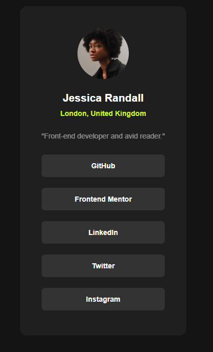

# Frontend Mentor - Social links profile solution

This is a solution to the [Social links profile challenge on Frontend Mentor](https://www.frontendmentor.io/challenges/social-links-profile-UG32l9m6dQ). Frontend Mentor challenges help you improve your coding skills by building realistic projects. 

### The challenge

Users should be able to:

- See hover and focus states for all interactive elements on the page

### Screenshot

### Links

- Solution URL: [GitHub](https://github.com/FilipSzkarlat/social-links-profile-main)
- Live Site URL: [Netlify](https://social-links-profile-by-filip.netlify.app)

### Built with

- Semantic HTML5 markup
- CSS custom properties
- Flexbox

## Author

- Website - [Portfolio](https://filipszkarlatportfolio.netlify.app)
- Frontend Mentor - [@FilipSzkarlat](https://www.frontendmentor.io/profile/FilipSzkarlat)
- LinkedIn - [Filip Szkarlat Szczepaniak](https://www.linkedin.com/in/filip-szkarlat-szczepaniak/)